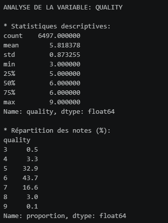
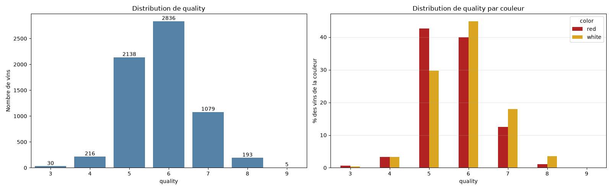
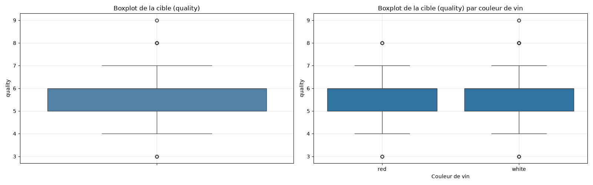
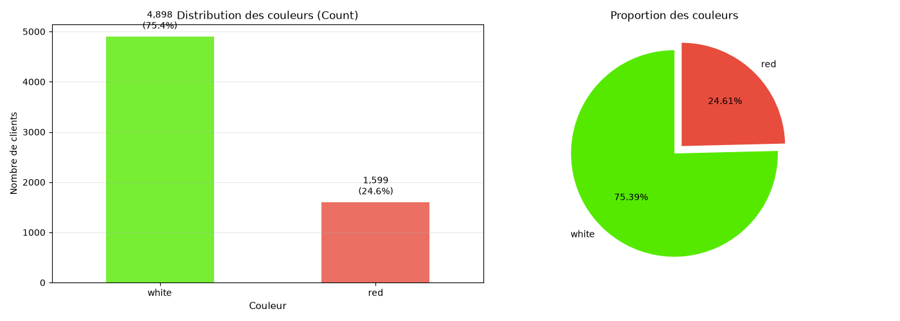

# Projet MLOps - M2 Data Engineering & AI

Projet MLOps dans le cadre du M2 Data Engineering & AI de l'EFREI

Dataset : [Wine Quality](https://archive.ics.uci.edu/dataset/186/wine+quality)

## Analyse exploratoire des données

### La cible : quality

La cible est une variable entiere, entre 3 et 9 :

Voici la distribution des différentes valeurs de la cible :

Voici un boxplot de la cible :

### Les couleurs des vins : color

La couleur des vins est une variable catégorielle :

Cette variable a été ajoutée en fusionnant les deux fichiers du dataset.

### Les autres variables du dataset

Les autres variables du dataset sont quantitatives :

- fixed acidity
- volatile acidity
- citric acid
- residual sugar
- chlorides
- free sulfur dioxide
- total sulfur dioxide
- density
- pH
- sulphates
- alcohol

Leurs distributions suivent des courbes en cloche.

Certaines variables peuvent présenter des légères asymétries ou des valeurs aberrantes.

Exemple avec la variable `volatile acidity` :

